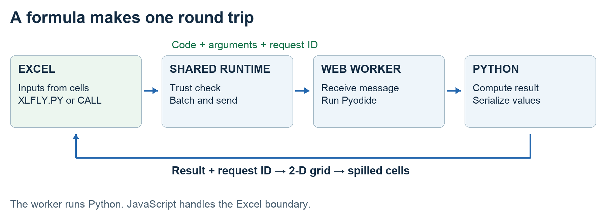
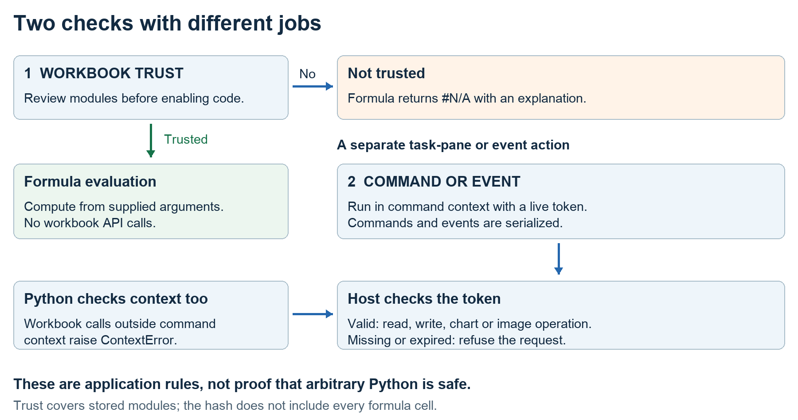
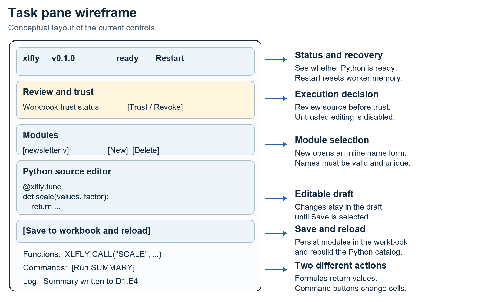

# Building Python into Excel with Pyodide

A practical walkthrough of the architecture, Git workflow, source code and agent prompts behind xlfly.

Excel is where many teams already keep their data. Python is where they want to clean it, calculate with it, and build repeatable analysis. Bringing the two together sounds like a small integration task. It quickly becomes a set of design decisions: where does Python run, how does it receive a range, and who is allowed to write results back?

This walkthrough follows xlfly, an Office Add-in that runs Python locally through Pyodide. We will begin with the requirements, explain the stack, clone the actual repository, and build a small example. Then we will follow a calculation through the implementation and use a command to write a summary and create a chart. Each stage includes a reusable coding-agent prompt and a checkpoint.

You can read the explanations without being a programmer. If you want to build along, the commands and examples provide a practical path. Developers can continue into the companion source walkthrough, which reproduces the complete tracked add-in text files, explains their responsibilities, and includes the tests. The repository also contains the icon assets and build configuration.

The implementation reference is **xlfly Implementation Blueprint Revision 3**, especially sections 2–6 for architecture and section 10.1 for real-Excel evidence. The code snapshot is commit `27b4fcaf3c92b6b7fa45e5db57631505bdc4f330`, on branch `feat/mac-office-addin`, inspected on October 30, 2026. The prompts below are newly written learning prompts, not a claimed transcript of how the repository was originally built.

## Begin with the smallest useful outcome

Start with a user story: an analyst selects numbers in Excel, calls Python from a formula, and receives a result in the sheet. A second story is different: the analyst presses a button to write a report and insert a chart. Keeping those stories separate gives the project its most important rule. A formula calculates a result; a command changes the workbook.

The first milestone should therefore be small. Pass one number to Python, double it, and return it. Next, pass a range and return a column of results. Only then add reusable functions, workbook storage, commands, and charts. A beautiful editor does not prove that the Excel-to-Python round trip works.

The blueprint's constraints explain the rest of the design: target Excel on Mac, Windows, and the web; avoid requiring a native Python installation for end users; keep computation on the user's device; and allow workbook operations through an explicit API. These are target requirements, not a promise that every feature has passed testing on every host.

### Agent prompt for the project brief

> Read docs/xlfly-comprehensive-implementation-blueprint.md and addin/README.md. Write a one-page project brief for mixed technical and nontechnical readers. Identify the user stories, target platforms, non-goals, and the smallest demonstrable milestone. Separate formulas from commands. Use the blueprint's dated verification section when it conflicts with the README. Do not implement yet. Finish with observable acceptance criteria and unresolved assumptions.

**Checkpoint:** You can describe success without naming a framework: a cell input becomes a Python result; a separate user action can write a report.

## Choose the stack from the constraints

An Excel add-in is a small web application running inside Excel. Office.js gives that application access to workbook operations through an API, a defined set of operations that code can request. TypeScript helps keep the messages and values consistent as the project grows. HTML and CSS provide a lightweight task pane. These choices fit a project that needs to work across operating systems using the Office Add-in platform. [1]

**Office Add-in and Office.js connect the application to Excel.** They provide a shared web-based foundation for the target hosts, while the available Office APIs determine which workbook operations the add-in can perform.

**TypeScript keeps the application contracts explicit.** It describes the messages and results exchanged between the host and the worker. The build turns that source into JavaScript.

**Pyodide supplies the Python engine.** It runs CPython compiled for WebAssembly, with startup time and package compatibility as deliberate engineering considerations.

**A module Web Worker runs the calculations.** Python executes away from the task-pane thread and communicates through messages. The Office shared runtime lets the pane and custom functions share the same application state and kernel client.

**Node.js, npm and esbuild prepare the distribution.** They install dependencies, bundle the host and worker, and copy the required runtime assets into a folder served over HTTPS.

**Workbook custom XML stores the Python modules.** The code travels with the workbook, while trust decisions are stored separately on the user's side.

**HTML, CSS and ordinary DOM code provide the interface.** The editor, function catalog, command buttons and log do not require an additional UI framework.

The blueprint records a change from an earlier Windows-specific native approach to the Office Add-in approach. That is a useful lesson: choose the extension mechanism after deciding which hosts matter. A native bridge can be appropriate when access to local processes or native libraries is central. It introduces a different installation and platform-support problem.

Another option is a Python service. That moves interpreter management to a server, but introduces hosting, network latency and a data-transfer boundary. Microsoft's built-in Python in Excel is a separate product whose calculations run in Microsoft's cloud. xlfly uses the `XLFLY` namespace; its formulas must not be confused with Microsoft's `=PY` function. [2]

### Why Pyodide

Pyodide is CPython compiled to WebAssembly, a binary format that a browser runtime can execute. It lets this add-in run real Python on the user's device. The developer ships the interpreter as web assets; an end user does not need to install a separate Python distribution. Pyodide also provides a route to compatible scientific packages such as NumPy, pandas and matplotlib.

That fit comes with limits. A desktop Python wheel is not automatically a WebAssembly-compatible wheel. Python does not gain unrestricted access to the user's disk, operating-system processes or native database drivers. Pyodide has a virtual filesystem, and browser-mediated networking remains possible subject to browser rules. Local computation therefore does not establish a guarantee that code can never send data over a network. [3]

The worker is equally important. A long calculation should not occupy the task pane's JavaScript thread. In the current Pyodide release used here, the worker must be created as a module worker. xlfly sends requests to it, waits for results, and can terminate it if a calculation hangs. Termination loses in-memory Python state; modules must be loaded again. [4]

Choose Pyodide when browser-hosted Python, compatible packages and no native end-user installation fit the job. Revisit that choice when the core requirement is a native extension, a direct local database connection, an operating-system integration, or work that exceeds practical browser memory and startup limits.

### Agent prompt for the architecture decision

> Using the brief and the blueprint, compare an Office Add-in with Pyodide, a native Python bridge, and a remote Python service. Explain where code runs, how it reaches Excel, deployment requirements, package constraints and data movement. Recommend a stack for this brief. Preserve the distinction between cross-platform intent and verified host support. Record the decision in a short architecture note before creating files.

**Checkpoint:** Every chosen technology answers a requirement. The architecture note also states which future requirement would make the choice unsuitable.

## Get the repository and understand Git

Git records versions of a project. GitHub hosts a copy that people can share. A **clone** is your local copy, a **branch** is a line of work, and a **commit** is a recorded snapshot. A **remote** is the address of another copy; `origin` is its conventional name after cloning.

The inspected checkout reports this remote:

```text
origin  https://github.com/qaflabindia/xlfly.git
```

Install Git and a current supported Node.js LTS release before starting. The repository asks for Node.js 22 or later; use a sufficiently recent release with native TypeScript execution because its test scripts invoke `.ts` files directly. Python 3.13 or later is a practical choice for the separate CPython test suite; the checks recorded for this article ran with Python 3.14.7. That development interpreter is separate from the Python supplied by Pyodide to end users.

Check the tools in Terminal on macOS or PowerShell on Windows:

```bash
git --version
node --version
npm --version
python3 --version
```

On Windows, Python may be available as `py` rather than `python3`. The repository's `test:py` script calls `python3`; either provide that command or run its equivalent with `py -3` from the `addin/python` directory.

Clone the repository, inspect its branches, and select the implementation branch:

```bash
git clone https://github.com/qaflabindia/xlfly.git
cd xlfly
git remote -v
git fetch origin
git branch -a
git switch feat/mac-office-addin
git rev-parse HEAD
git switch -c codex/newsletter-lab
```

`git switch` can create a local tracking branch when there is one matching remote branch. If the feature branch has moved or been merged, use the branch containing `addin/` and the Revision 3 blueprint. To reproduce this article exactly, after fetching the commit, create your branch from the recorded snapshot:

```bash
git switch -c codex/newsletter-snapshot 27b4fcaf3c92b6b7fa45e5db57631505bdc4f330
```

If the repository requires access, sign in with an account that has it. Use the recorded commit to keep your reading aligned with this walkthrough.

Read `docs/xlfly-comprehensive-implementation-blueprint.md` first, followed by `addin/README.md` for commands. The root repository may contain earlier work; the browser-based implementation covered here lives in `addin/`.

### Agent prompt for repository orientation

> Inspect the current folder before changing anything. Read applicable AGENTS.md files, git status, git remote -v, the current branch, the implementation blueprint and addin/package.json. Identify the browser-based add-in and summarize its source folders. Report the exact available scripts and prerequisites. Preserve existing edits. Do not switch branches, install certificates or publish changes without an explicit instruction for that action.

## Build the existing project before extending it

Run these commands from `xlfly/addin`. `npm ci` installs the versions recorded in the lockfile rather than selecting a new dependency tree. `fetch:pyodide` downloads the selected Python packages and checks their hashes. The build creates `dist/`, the folder Excel will load from the development server.

```bash
cd addin
npm ci
npm run fetch:pyodide
npm run build
```

The core arithmetic example does not require pandas or matplotlib. Fetching packages now prepares the fuller walkthrough. The package-fetch script starts with NumPy, pandas and matplotlib, follows their dependencies in Pyodide's lockfile, and verifies each download's SHA-256. The Office.js script is still loaded from Microsoft's hosted URL; self-hosting Pyodide does not make the entire application offline.

Next, set up local HTTPS and start the server:

```bash
npm run certs
npm run serve
```

The certificate command creates and trusts a development certificate and may ask for your operating-system password. Keep the server terminal running at `https://localhost:3000`. The project has no live rebuild watcher: after changing source, run `npm run build` again and reload the add-in. Do not edit `dist/app.js` as your source; the next build replaces it.

### Load it into Excel

On Mac, open a second terminal in `xlfly/addin`, run the command below, then quit and reopen Excel. The script copies the generated manifest into Excel's `wef` folder. Open xlfly from Home → Add-ins or the Python ribbon button. This is the path exercised in the blueprint's real-Mac run. [5]

```bash
npm run sideload:mac
```

On Windows, use an Office add-in trusted catalog or Microsoft's documented sideload tooling to register `dist/manifest.xml`; the repository's Mac shell scripts do not perform Windows setup. On Excel for the web, use the add-in upload route for the XML manifest, when enabled by your organization's settings. The browser must be able to reach and trust the HTTPS URL in that manifest. UI wording and available sideload routes vary by host and policy. [6]

The manifest requests SharedRuntime 1.1. It points the task pane and custom functions at the same page and asks for a long-lived runtime. This gives them shared application state, including the worker client and trust decision. It does not remove the need to test host lifecycle behavior. [7]

### Agent prompt for a reproducible first build

> Work in addin/. Use the checked-in package-lock.json and scripts. Explain each setup command before running it. Install dependencies, fetch the self-hosted Pyodide packages and build. Confirm dist contains the manifest, task pane, app.js, kernel.js, functions.json, python-bundle.json and Pyodide runtime files. Explain the host-specific sideload step separately. Report actual failures and do not describe a build as an Excel compatibility test.

**Checkpoint:** The task pane loads, the version is visible, and `=XLFLY.VERSION()` returns the add-in version. A loaded pane alone does not prove that Python works.

## Make the first formula work

Use a new test workbook. In the xlfly pane, review the displayed code and trust this workbook. Saving the starter module registers its functions. Trusting enables execution; it is not an analysis proving the workbook's Python harmless.

Put `12`, `7.5`, `40` and `3` in cells A1:A4. Put this formula in B1 and leave B2:B4 empty:

```excel
=XLFLY.PY("[[v * 2] for row in arg1 for v in row]", A1:A4)
```

The expected output is 24, 15, 80 and 6. The range arrives in Python as a list of rows. The expression visits each value and returns a column-shaped list. Excel spills that result into adjacent cells. If the destination is occupied, Excel can report a spill error.

Do not use `arg1 * 2` to double a multi-cell range: in Python, multiplying a list repeats it. That shorter expression is appropriate for a scalar input such as A1. xlfly unwraps a 1×1 input into its scalar value, so the shape of the input matters.

Inline `XLFLY.PY` is implemented and exercised by automated kernel tests. The blueprint explicitly leaves its real-Excel verification open. Treat this step as a host-validation exercise and record the result. The next registered-function path has a recorded Mac success in the blueprint.



Figure 1. The formula supplies values to JavaScript, which sends a request to the worker. Python computes and returns a serializable value. The host shapes it for Excel.

## Add a reusable function and a report command

Create a module named `newsletter` in the pane. Paste this complete example, save it to the workbook, and use the formula below. The helper accepts a scalar or a range, ignores blanks and text, and excludes booleans from numeric analysis.

```python
import xlfly


def numbers(value):
    rows = value if isinstance(value, list) else [[value]]
    for row in rows:
        cells = row if isinstance(row, list) else [row]
        for cell in cells:
            if isinstance(cell, (int, float)) and not isinstance(cell, bool):
                yield cell


@xlfly.func
def scale(values, factor):
    """Scale the numeric values and return one column."""
    return [[value * factor] for value in numbers(values)]


@xlfly.command
async def summary():
    """Read A1:A4 and write a small summary on the active sheet."""
    rows = await xlfly.Range("A1:A4").read()
    values = list(numbers(rows))
    if not values:
        raise ValueError("A1:A4 contains no numbers")
    report = [
        ["Metric", "Value"],
        ["Count", len(values)],
        ["Total", sum(values)],
        ["Average", sum(values) / len(values)],
    ]
    await xlfly.Range("D1").write(report)
    await xlfly.chart(
        "column", "D1:E4", "G2", title="Input summary"
    )
    await xlfly.log("Summary written to D1:E4")
```

```excel
=XLFLY.CALL("SCALE", A1:A4, 2)
```

`@xlfly.func` registers SCALE in the Python function catalog. It does not add a new Excel function name dynamically. Excel sees the already-declared `XLFLY.CALL` and passes the string SCALE to Python. This distinction is why the metadata file declares a small stable set of Excel entry points.

Run SUMMARY from the task pane. It reads the input, writes D1:E4, and creates an editable native chart at G2. For our sample, the count is 4, total is 62.5 and average is 15.625. Use an empty area: the command writes values into the workbook. Each run currently adds another chart; replacing a chart is future lifecycle work.

The `async` function and `await` expressions allow the command to pause while Office.js completes an operation. A worksheet function may not call the workbook API. The JavaScript transport can return a Promise to Excel while the user-defined Python formula itself must return a synchronous value.

### Agent prompt for the first useful extension

> Add a newsletter example module using the existing public xlfly API. Provide a SCALE function and an async SUMMARY command. Handle scalar and matrix inputs, skip blanks and nonnumeric values, and exclude booleans. Specify the exact input cells and expected results. Use a fresh workbook area for writes. Explain that repeated chart insertion creates duplicates. Validate Python behavior with a fake host, then list the separate real-Excel checks still required.

## Follow the calculation through the implementation

The source companion follows the same sequence below. Each file appears in full, without replacing difficult parts with ellipses. Start with the responsibilities, then inspect the implementation details that interest you.

**Registration and application state.** `manifest.xml` links Excel to the add-in. `src/functions/functions.json` declares VERSION, PY and CALL. `src/app.ts` associates those IDs with JavaScript callbacks, converts arguments, checks workbook trust, and sends evaluation requests to the batcher. A global application instance prevents duplicate bootstrap work in the shared page.

**Batching and messages.** `src/host/batcher.ts` groups calls queued in the same event-loop turn, with a default threshold of 1,000. Each call gets its own ID. `src/shared/rpc.ts` adds request IDs, responses, notifications, version checking and timeout tracking. RPC means remote procedure call: here, one side asks the other to perform an operation by sending a message. Both sides run on the user's device. Batching reduces messaging overhead; it does not execute 1,000 Python functions in parallel.

**Worker lifecycle.** `src/host/kernel-client.ts` owns the worker, starts it lazily and keeps the module sources for reload. The defaults allow 180 seconds for startup, 30 seconds for a worksheet-function batch, 120 seconds for module loading, and 300 seconds for commands or events. A function timeout terminates the worker and sets it to stopped; a later request starts it and reloads modules. A timeout field on an RPC message is not itself a Python interrupt.

**Python startup.** `src/kernel/worker.ts` imports `pyodide.mjs` and fetches `python-bundle.json`. `kernel-core.ts` writes the bundled xlfly package into Pyodide's virtual filesystem, adds its root to Python's import path, installs a host bridge and exposes kernel methods. Imports in submitted source are inspected to load supported Pyodide packages. A failed package load is logged; it does not make an unavailable package usable.

**Evaluation.** `python/xlfly/_runtime.py` parses cell code into a Python syntax tree. It executes the statements and evaluates the final expression separately, which makes the final expression the result. It caches up to 256 compiled snippets. Registered calls look up functions by name. Exceptions become structured errors; an awaitable returned by a worksheet function is refused.

**Values.** The shared TypeScript converter and Python `_types.py` agree on numbers, strings, booleans, nulls, error objects and row-major matrices. Empty cells become `None`; one-dimensional outputs become columns; ragged rows are padded. DataFrames can include headers, and NaN or infinity becomes `#NUM!`. Formula errors and values written through a command take different paths: command writes serialize error markers as text.

**Dates.** The helper uses the 1900 date-system convention and removes timezone information from timezone-aware datetimes. Do not assume complete historical-date or 1904-workbook handling. Confirm date-system and timezone expectations before using these helpers in reporting.

### Agent prompt for the calculation boundary

> Read values.ts, _types.py, rpc.ts, batcher.ts, kernel-client.ts, worker.ts, kernel-core.ts and _runtime.py in dependency order. Explain one SCALE call from Excel arguments to a returned grid. Preserve IDs, the v1 message contract, error mapping, scalar unwrapping and JSON boundaries. Add or adapt tests for shapes, errors, late replies and timeout recovery if changing behavior. Do not replace complete files with pseudocode or change contracts silently.

## Understand commands and trust

Commands need to call back from Python into Excel. The Python API in `_api.py` delegates through `_host.py`. `_context.py` refuses those operations outside command context. On the JavaScript side, `KernelClient` also requires a live token belonging to the active command or event. The token is removed when that operation finishes. A Promise chain serializes commands and events.

The host services in `excel-services.ts` use `Excel.run` and `context.sync` to read ranges, write values and create charts or images. A range write grows from the supplied top-left cell to match the returned matrix. Reads and writes above two million cells are refused. `xlfly.call` currently accepts scalar arguments for Excel functions; it is not an unrestricted mirror of every Excel function signature.



Figure 2. Trust gates worksheet evaluation and module loading. Commands and event callbacks use a separate live-token check before the host executes workbook operations.

Workbook modules are stored as base64-encoded JSON inside a custom XML part. Base64 preserves source through XML; it is not encryption. The trust key hashes the workbook location, workbook ID, and sorted module names and source. Trust is kept in OfficeRuntime storage, with localStorage as a fallback, rather than inside the workbook itself.

The pane intentionally trusts code saved by the already-trusted editor. An externally changed module set should produce a different key when code and trust are loaded again. This is not continuous monitoring of every external edit. The hash also does not include every formula cell: trusting a workbook enables inline PY execution too. These details are important when explaining what the trust decision covers.

The context checks enforce application rules around the exposed workbook services. They are not a complete sandbox against adversarial Python. Pyodide's JavaScript interoperation and browser networking need separate threat analysis if hostile code is in scope. A Web Worker primarily isolates execution from the page thread.

Events arrive through `app.ts`. The write tracker suppresses recently written addresses for about 1.5 seconds. Its normalization drops the sheet name, so this is a heuristic, not a reliable identity system for all overlapping or cross-sheet changes. The blueprint marks real-Excel event behavior as unfinished validation.

### Agent prompt for workbook operations

> Trace Range.read, Range.write and chart from _api.py through _host.py, the RPC token guard and excel-services.ts. Preserve the Python context check and host live-token check. Explain command serialization, range limits and token cleanup. Trace trust hashing separately and state what it includes and excludes. Do not claim that context tokens or a Web Worker make arbitrary Python safe. Verify stale-token refusal and formula access refusal in tests.

## Make the interface explain the system

The task pane needs to answer five practical questions: Is Python ready? Is this workbook trusted? Which module am I editing? Which functions and commands are available? What happened last? The existing interface maps directly to those questions.



Figure 3. A conceptual wireframe of the current controls, not a screenshot. Review precedes trust; saving reloads modules; command output appears in the log.

`taskpane.html` provides the controls, `taskpane.css` styles them, and `taskpane.ts` binds them to the application. Draft edits are kept separate from the saved document. The New button opens an inline name form because a browser prompt is unsuitable in the Office webview. Module names are validated before adding a draft. The catalog shows formulas separately from runnable commands.

That distinction should be visible in the interface. A user should not have to infer why `XLFLY.CALL("SUMMARY")` fails: SUMMARY is a command, so it belongs to a button action. The blueprint identifies a clearer command-name error as planned work.

### Agent prompt for the task pane

> Implement or refine the task pane using the existing App methods and the wireframe. Include status and Restart, review and trust controls, module selection with an inline New form, a source editor, Save and reload, separate function and command catalogs, and a log. Preserve unsaved drafts during status updates. Use textContent for user text and accessible labels. Check untrusted, starting, ready and failed states. Keep implementation details out of user-facing labels unless they help the user act.

## Build a similar project from an empty folder

Cloning is the quickest way to reproduce the article. Building a new add-in is a different exercise. Begin with the brief and architecture decision above, then create a small repository:

```bash
mkdir my-python-excel-addin
cd my-python-excel-addin
git init
npm init -y
```

Create a `.gitignore` for `node_modules/`, `dist/`, `vendor/` and `__pycache__/`. Establish the package scripts and dependency versions deliberately. You can use the source companion's package.json and lockfile as a matched reference for this snapshot; keep the lockfile under version control. Give an independently distributed add-in its own manifest GUID, name, URLs and branding.

Build in this order so each stage has a usable output:

1. Create the manifest, function metadata and task pane. Make VERSION return a string before adding Python.
2. Add the symmetric RPC protocol and value converters. Test them without Excel.
3. Load Pyodide in a module worker and return the result of `1 + 1`.
4. Connect PY and CALL through the batcher and client. Test scalar and range results.
5. Add module persistence and a visible trust flow before loading workbook code automatically.
6. Add command context, token-guarded Office services and one report command.
7. Add the editor, catalogs and logs, then test lifecycle behavior in real Excel.

Use the prompts as a sequence. Give each stage the files and decisions produced by the previous stage. Require the agent to summarize changed files, tests and remaining uncertainty after each checkpoint. This makes integration visible and reduces the chance of separately generated parts disagreeing about field names or value shapes.

### Shared instruction for the build prompts

> Continue from the existing project; do not start a second implementation. Read the blueprint and the previous stage's handoff. Preserve protocol v1, the wire value format and the formula-versus-command rule. Make a bounded change, include complete changed source, and run the relevant checks. Report what actually ran, what passed, and what still needs real Excel. Keep credentials, generated bundles and machine-specific files out of commits. Do not claim unsupported platforms are verified.

### Agent prompt for packaging

> Add or explain build.mjs and the development scripts. Bundle the host as an IIFE and worker as an ES module, package the Python sources as JSON, copy Pyodide and static assets, and substitute the base URL into the manifest. Fetch package dependencies from the Pyodide lockfile with checksum verification. Separate local HTTPS development from production hosting. Use a distinct manifest identity if creating an independent product. End with a file inventory and one reproducible build command.

## Use Git to keep each step reviewable

A small commit is easier to review and undo than a week of unrelated work. After a stage, inspect the changes, stage only the intended source files, and commit them. For example, if you changed the runtime and its tests, run this from the repository root:

```bash
git status
git diff
git add addin/python/xlfly/_runtime.py
git add addin/python/tests/test_runtime.py
git diff --staged
git commit -m "Improve worksheet result handling"
git log --oneline -5
```

`git add` selects changes for the next commit; it does not upload them. `git commit` records them locally. When ready and authorized to share, `git push -u origin codex/newsletter-lab` uploads that branch. If you do not have write access to the original repository, work in your own fork and open a pull request. Do not force-push as part of this beginner workflow.

The source snapshot preserves `package.json` with `private: true` and `license: UNLICENSED`; this walkthrough does not change the repository's distribution terms.

## Verify the behavior and state the limits

From `addin/`, run the existing checks:

```bash
npm run typecheck
npm test
npm run test:py
npm run test:kernel
npm run build
```

`npm run check` runs that sequence for you. Validation for this article passed all five stages: 19 JavaScript unit tests, 14 CPython unit tests, one real-Pyodide integration test, TypeScript checking and the build. The integration test uses fake Excel services. It tests the kernel and bridge but cannot establish real Office.js behavior.

The blueprint's October 30 Mac run records successful sideloading, shared-runtime and worker startup, a registered range function with spilled results, the trust action, command reads and writes, native charts, and manual kernel restart. Those are recorded project observations, not Excel tests rerun while drafting this article.

**The automated checks passed for this snapshot.** TypeScript checking, JavaScript and Python unit tests, the real-Pyodide integration test, and the build provide evidence about the implementation. Extend those checks when behavior changes.

**The blueprint records specific successes on Mac.** Registered functions, spilled results and native charts worked in the recorded run. Readers should repeat those checks with their own Excel version.

**Several real-host checks remain open.** Inline PY, automatic recovery from a hung calculation, images, events, trust persistence and outside edits still need the relevant Excel validation. Automated coverage does not replace those observations.

**Windows and the web remain target platforms.** The architecture is intended for them, but the complete host test matrix has not been recorded as passed.

**Release packaging is a separate milestone.** A successful local build does not resolve manifest validation, production hosting or deployment requirements.

The README still contains an older statement that the add-in has not been verified in real Excel. Use the newer dated blueprint section for the more specific status. The blueprint also records a manifest-validation failure for version `0.1.0.0`. Treat release readiness as separate from a successful sideload; increasing a version number alone does not establish marketplace acceptance.

### Agent prompt for final verification

> Run the repository's existing check suite and report exact results. Compare the implementation with blueprint sections 10 and 10.1. Create a Mac, Windows and web validation checklist covering formulas, spills, errors, trust persistence, outside edits, commands, images, events, hangs and restart. Distinguish mock-host tests from real Excel observations. Record unresolved release requirements without presenting future work as complete.

The next useful milestone is a repeatable host test, not another abstraction: open a fresh workbook, review and trust its module, calculate a result, run the summary, save and reopen, and record exactly which steps succeed. That is how a local prototype becomes evidence for a dependable add-in.

## Explore the code and try it yourself

The [complete source walkthrough](python-inside-excel-complete-source.md) contains the complete tracked add-in text source in a guided reading order, plus configuration, tests, lockfile and original README. The repository preserves the tracked add-in files, including icons, and the implementation blueprint. Generated bundles, downloaded runtimes and dependencies are rebuilt using the instructions above.

Repository: [qaflabindia/xlfly on GitHub](https://github.com/qaflabindia/xlfly)

Implementation reference: [xlfly Implementation Blueprint](../xlfly-comprehensive-implementation-blueprint.md), Revision 3, sections 1–12. Snapshot: 27b4fcaf3c92b6b7fa45e5db57631505bdc4f330. The source companion maps the narrative to specific files and includes file hashes.

Official references consulted on October 30, 2026:

[1] [Microsoft Learn — Build Excel add-ins with Office Add-ins.](https://learn.microsoft.com/en-us/office/dev/add-ins/excel/excel-add-ins-overview)

[2] [Microsoft Support — Data security and Python in Excel.](https://support.microsoft.com/en-us/excel/python/data-security-and-python-in-excel)

[3] [Pyodide — Python compatibility.](https://pyodide.org/en/stable/usage/wasm-constraints.html)

[4] [Pyodide — Using Pyodide in a web worker.](https://pyodide.org/en/stable/usage/webworker.html)

[5] [Microsoft Learn — Sideload Office Add-ins on Mac for testing.](https://learn.microsoft.com/en-us/office/dev/add-ins/testing/sideload-an-office-add-in-on-mac)

[6] [Microsoft Learn — Sideload Office Add-ins to Office on the web.](https://learn.microsoft.com/en-us/office/dev/add-ins/testing/sideload-office-add-ins-for-testing)

[7] [Microsoft Learn — Configure your Office Add-in to use a shared runtime.](https://learn.microsoft.com/en-us/office/dev/add-ins/develop/configure-your-add-in-to-use-a-shared-runtime)

Which would be most useful in your Excel workflow: reusable Python formulas, a report-generation button, or event-driven automation? Start with that use case, then build and test the smallest version of it.
